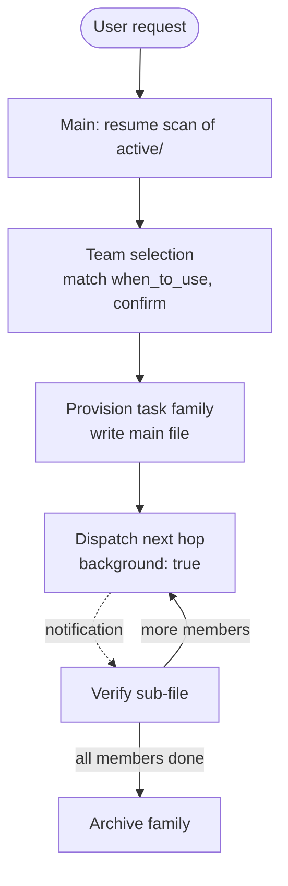

# lilliput

**Stop losing context in long conversations.** Lilliput keeps an AI team's state in **plain files — not in the chat** — so disposable subagents hand off work like a relay, and a fresh session can pick up exactly where the last one stopped.

```bash
npx skills add chenqb0309/Lilliput
```

## The problem it solves

| Without Lilliput | With Lilliput |
|---|---|
| Context explodes; the agent forgets earlier steps | State lives in files on disk, not in the chat |
| One agent does everything | Specialized roles relay the work |
| Restarting the session = starting over | A new session resumes from the main file |
| "Did it really do that?" | Every hop leaves an auditable sub-file |

## See it in action

```
You:  Use the dev-flow team to refactor the login module.

Main: Using dev-flow (sub_doc → sub_test → sub_code → sub_audit). Confirm?
You:  go
```

Lilliput provisions a **task family** and relays it, one role at a time:

```text
<home>\workspaces\_teams\dev-flow\active\
├─ 20261118_login-refactor.md        ← main file: identity & state (single source of truth)
├─ 20261118_login-refactor.001.md    ← sub_doc : task board
├─ 20261118_login-refactor.002.md    ← sub_test: tests first
├─ 20261118_login-refactor.003.md    ← sub_code: implementation
└─ 20261118_login-refactor.004.md    ← sub_audit: audit report
```

Then **close the window and open a new session**: Lilliput reads the main file, sees which hop is next, and resumes. No memory, no lost context.

A full worked example lives in [`examples/dev-flow-login-refactor/`](./examples/dev-flow-login-refactor/).

## Architecture



The **main file is the single source of truth**; every hop appends one immutable sub-file. Because state is on disk, any new session can rebuild the picture from the files alone.

## Core concepts

| Concept | Description |
|---|---|
| **Soul** | A role definition (scope & boundaries + SOP) stored under `souls\`. |
| **Soul Tree** | Two-level lookup: department (`_branch.md`) → role (`<soul>.md`); root is `souls\index.md`. |
| **Team** | A reusable **workflow template** = an ordered `soul_id` list, stored under `teams\`. |
| **Task family** | One task's context: a **main file** (single source of truth) + ordered **sub-files** + independent artifacts. |
| **Main Agent** | Project manager: traverse the tree, pick a team, provision the task family, dispatch, verify, archive — never doing specialized detail work itself. |

## How it compares

| Approach | Where the state lives | Who defines the workflow | Survives a restart |
|---|---|---|---|
| `AGENTS.md` / system prompt | the prompt | you, implicitly | No |
| CrewAI / AutoGen | in-process memory | code-defined crews | Not by default |
| LangGraph | a graph you write | explicit state machine in code | Only with your own checkpointing |
| Ad-hoc subagent delegation | the chat | ad-hoc, per request | No |
| **Lilliput** | **plain files on disk** | **declarative teams + human-gated recruitment** | **Yes — resume from the main file** |

Lilliput is deliberately small: it is a **protocol**, not a runtime. It composes with any agent that can run subagents and read/write files.

## Install

**One-liner (skills CLI):**

```bash
npx skills add chenqb0309/Lilliput
```

> Requires Node.js ≥ 22.20. The CLI installs into your coding agent (OpenCode, Claude Code, Codex, Cursor, …).

**Manual install:**

```bash
git clone https://github.com/chenqb0309/Lilliput
cd Lilliput
copy config.example.json config.json     # Windows  (POSIX: cp config.example.json config.json)
```

Then place the folder in your agent's skills path and edit `config.json`'s `home` if needed
(env syntax `%USERPROFILE%` / `$HOME` is resolved at load time).

On first load the skill runs **Bootstrap**: it creates the `home` tree, the standard roles, and the standard teams.

> `config.json` is a local machine setting and is **not version-controlled** (see `.gitignore`);
> only `config.example.json` is tracked.

## Layout

```text
<home>\
├─ souls\                       roles (index.md / per-department _branch.md / <soul>.md)
├─ teams\                       workflow templates (index.md / <team_id>.md)
├─ workspaces\
│   ├─ _teams\<team_id>\        active\  archive\   (team task family home)
│   └─ <soul_id>\               active\  archive\  scratch\
└─ _legacy\                     retired assets
```

The **task family home** is routed by `team_id`: team tasks → `workspaces\_teams\<team_id>\`;
personal tasks → `workspaces\<soul_id>\`. `scratch\` holds one-off intermediates and is **not archived**;
evidence to keep is written as an **independent artifact** in the task family home.

## Standard roster (created by Bootstrap)

- Roles: `sub_doc` (docs), `sub_code` (implementation), `sub_test` (tests), `sub_audit` (audit)
- Teams: `dev-flow`, `doc-only`

**Domain roles** (e.g. database query, equipment experts, project management) are *not* standard —
they are created through the **Recruitment** proposal, approved by a human. **Domain teams** follow the
same rule via the **Team Proposal**.

## Operating flow (Main Agent)

```
Resume scan (unarchived tasks in active\)
 → Team selection (match teams\index.md against when_to_use; confirm; optionally suggest a single-soul task)
 → Soul Tree traversal (verify members exist; recruit if missing)
 → Provision the task family (write the main file; write intent first)
 → Dispatch (background: true; wait for the notification)
 → Claim by receipt → verify → unidirectional handoff → archive
```

## Security

- This spec contains **no credentials or host information**; domain details (connections, paths) live in the
  **local data directory** and are never version-controlled with the skill.
- Keep the `home` directory out of any public version control.

## Design notes

- **No back-edges.** A team is a one-way relay. If audit finds issues, it reports to Main and the human opens a
  new round (a new task family) — the `hop_count` never decreases.
- **Recovery over memory.** Authoritative task state lives in the main file's front matter, not in the
  conversation, so a new Main can resume after an interruption.
- **Evidence is durable, scratch is not.** Anything worth keeping is an artifact in the task family home and
  is archived with the family.
- **Derived hop limit.** A chain's length equals its team's `members.Count` (a personal task is one hop), so the
  circuit breaker needs no global setting — growing or shrinking a team never breaks it.

## Author

Built by [Jet Chen](https://github.com/chenqb0309).

## License

MIT — see [LICENSE](./LICENSE).
